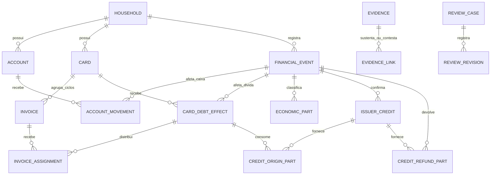

# ERD conceitual proposto para cartão, crédito e pagamento

**Status:** proposta conceitual revisada na Sprint 1, ainda não aprovada como esquema físico. Aplica ADR-006 a ADR-008 e ADR-017 a ADR-024 aos casos delimitados; não escolhe banco, ORM, nomes de tabelas, chaves, API nem política de isolamento. A estrutura geral de `Household`, `Transaction` e movimentos segue as ADR-007/017. Valores são centavos inteiros de BRL com moeda explícita (ADR-006).

## Perguntas que o modelo precisa responder

1. Qual fato alterou conta, dívida total e resultado econômico, em qual data e com qual fonte?
2. Qual crédito confirmado forneceu cada parcela aplicada ou devolvida, e quanto ainda resta a utilizar?
3. Qual fatura recebeu cada parte de uma compra, crédito aplicado ou pagamento? A atribuição veio do emissor, da regra da ADR-008 ou de estimativa manual?
4. Uma fonte nova repete, corrige ou contradiz um fato já reconhecido? Qual versão sustenta o cálculo atual?

## Alternativas consideradas para o desenho conceitual

| Caminho | Ganho | Custo diante das ADRs aceitas |
|---|---|---|
| Guardar apenas um saldo editável por fatura | Leitura simples do valor atual. | Perde a explicação de cada baixa, da origem do saldo e de correções históricas; não basta para ADR-022/024. |
| Fazer cada atribuição a fatura virar novo movimento de dívida | Permite consultar cada fatura como se fosse um livro separado. | Uma revisão de destino poderia duplicar ou alterar a baixa total, contrariando ADR-019/023. |
| Manter efeito financeiro único e atribuições revisáveis separadas **(proposta)** | Conserva caixa e dívida mesmo quando destino e classificação mudam; permite reconstruir a origem de cada saldo. | Exige conferir somas entre dimensões e guardar versões, fonte e base de cada atribuição. |

Esta escolha é **conceitual**: uma implementação pode derivar projeções de leitura ou persistir agregados reconciliáveis. Índices, constraints, transações de banco e desempenho serão comparados quando houver stack e primeiro fluxo definidos. Conceitos para estudo: fato financeiro, projeção, atribuição, proveniência, idempotência e revisão temporal.

## Relações conceituais

O diagrama mostra vínculos necessários, não multiplicidades finais de banco. Cada `EVIDENCE_LINK` precisa identificar **qual alegação** sobre confirmação de crédito, aplicação, pagamento, parte ou atribuição a fonte sustenta ou contesta; a conexão ao alvo foi abreviada no desenho e o tipo de vínculo físico fica pendente. `REVIEW_REVISION` preserva autor, motivo, data, base anterior e nova e fontes sem criar outro fato financeiro. Um vínculo opcional com compra ou despesa original explica estorno elegível ou redução de outra despesa; seu formato também fica para o esquema detalhado. A distribuição de parcelas de compra por ciclo segue a ADR-008 e precisa aparecer na modelagem geral de faturas, sem segunda despesa.

## Conceitos e identidade

| Conceito | Identidade e efeito | Relações e limite |
|---|---|---|
| `FinancialEvent` (`Transaction` da ADR-007) | Um acontecimento do household: compra, pagamento, crédito confirmado, aplicação ou devolução. A mera confirmação de crédito não movimenta caixa ou dívida; revisão do mesmo fato fica em `ReviewRevision`, sem novo evento financeiro. | Liga efeitos e fontes; classificar o evento não equivale a somar movimentos como receita/despesa. |
| `AccountMovement` | Mudança efetiva de uma conta; pagamento de fatura é saída, devolução recebida é entrada. | Conta e evento pertencem ao mesmo household. Transferência tem os dois movimentos opostos da ADR-007. |
| `CardDebtEffect` | Aumento por compra/encargo informado ou baixa por pagamento/aplicação de crédito; cada efeito confirmado entra uma vez na dívida total. | Mesmo cartão e household do evento. Fechamento de fatura não cria outro efeito. Um efeito pode ter destino entre faturas pendente. |
| `IssuerCredit` | Crédito confirmado pelo emissor, com cartão, valor, data, fonte e vínculo de compra quando confiável. | Pode ser aplicado em partes e/ou devolvido; confirmação isolada deixa valor a utilizar, sem efeito patrimonial no MVP. |
| `CreditOriginPart` | Parcela de uma aplicação de crédito atribuída a um crédito confirmado. | Permite aplicação agregada de vários créditos e um crédito usado em várias aplicações. Origem não identificada permanece em revisão, sem crédito inventado. |
| `CreditRefundPart` | Parcela do crédito devolvida à conta por entrada efetiva. | Não pode consumir os mesmos centavos que `CreditOriginPart`; natureza econômica do excedente devolvido segue pendente. |
| `EconomicPart` | Parte do efeito econômico: estorno elegível, redução de outra despesa documentada, receita por baixa ou parcela sem classificação. | Partes de aplicação somam a baixa; categoria, compra/despesa vinculada, mês do efeito e base manual ou inferida devem ser rastreáveis. Pagamento não cria despesa. |
| `Invoice` e `InvoiceAssignment` | Ciclo do cartão e atribuição de parcela de obrigação ou baixa a uma fatura. | Atribuições de crédito e pagamento são independentes; valor sem destino continua visível. Atribuição não cria outro efeito financeiro. |
| `Evidence`, `EvidenceLink`, `ReviewCase`, `ReviewRevision` | Fontes, correspondências propostas/confirmadas, conflito e histórico de resolução. | Várias fontes podem sustentar o mesmo fato; fonte conflitante não substitui valor automaticamente (ADR-021/022). Revisão exige autorização no household, motivo e trilha. |

Os nomes acima são vocabulário de estudo, não contratos de código. A mesma linha externa pode comprovar mais de uma dimensão do **mesmo** fato, sem multiplicar a aplicação; o mesmo fato pode ter várias fontes. O elo de evidência precisa guardar papel, data/escopo e estado da correspondência. A forma de persistir fonte externa por formato ainda não foi escolhida.

## Invariantes verificáveis

| ID | Conferência no modelo conceitual |
|---|---|
| I1 | Para cada crédito com origens atribuídas, `confirmado = aplicado + devolvido + a_utilizar`; parte sem origem impede saldo individual confirmado, mas não apaga aplicação global comprovada. Aplicação e devolução não usam a mesma parcela. |
| I2 | Cada aplicação comprovada gera uma baixa da dívida total igual ao valor aplicado. Suas partes econômicas somam esse valor separadamente de suas atribuições de origem e fatura. Classificar ou reatribuir não gera segunda baixa. |
| I3 | Para cada aplicação ou pagamento, `atribuído_a_faturas + sem_destino = valor_do_efeito`, considerando uma versão coerente da revisão. Nenhuma parcela excede o aberto da fatura na posição reconstruída; cartão e household coincidem. |
| I4 | Cada pagamento reduz caixa e dívida total pelo mesmo valor comprovado e não cria despesa. Pagamento parcial com crédito sem destino segue ADR-023: distribuição por fatura em revisão, sem alocação automática pelo aberto original. |
| I5 | Saldo individual só é pontual quando todas as atribuições necessárias estão determinadas. Sua origem é confirmada pelo emissor, calculada pela ADR-008 ou estimada pelo usuário conforme ADR-024; conflito aberto acrescenta qualificador contestado (ADR-022). A soma de saldos individuais para a mesma posição, cartão e data reconcilia com a dívida total quando completa. |
| I6 | Releitura da mesma evidência não cria segundo crédito, movimento, baixa ou parte. Fonte incompatível mantém o último valor sustentado nos cálculos como contestado até revisão rastreável; correção do mesmo fato recalcula efeitos históricos e revalida os posteriores. |
| I7 | Vínculos de conta, cartão, fatura, crédito, compra/despesa e revisão não atravessam household. Estratégia técnica de autorização e isolamento permanece pendente; esta invariável é requisito do domínio e de segurança, não uma escolha de RLS ou filtro. |

## Percurso do exemplo aprovado

No [ciclo com dois créditos e dois pagamentos](multi-credit-payment-cycle-example.md), A e B são dois créditos confirmados; suas aplicações criam duas baixas de dívida e duas partes econômicas. P1 e P2 criam duas saídas de conta e duas baixas de dívida, sem partes de despesa. Antes da prova dos destinos dos créditos, as atribuições às faturas e as dos pagamentos históricos ficam em revisão. Após prova de A/B na fatura nova e revisão rastreável de P1/P2 pela ADR-008, o saldo R$ 30/R$ 70 é **calculado pela regra**; só a prova dos destinos dos pagamentos o torna **confirmado pelo emissor**. A correção comprovada de B de R$ 20 para R$ 15 altera a mesma aplicação e suas partes: dívida R$ 105, caixa R$ 430, R$ 5 do crédito B a utilizar e faturas R$ 30/R$ 75 nesse cenário. O caso e sua versão anterior continuam consultáveis.

## Limites antes de transformar em esquema

- **Correspondência externa:** definir por formato quando linhas iguais são o mesmo fato, dois fatos ou conflito, inclusive aplicação agregada e fatura fechada. ADR-021 define o limiar de prova, mas não o identificador de importação.
- **Concorrência e versões:** decidir como uma revisão simultânea valida a posição, impede perda de atualização e preserva versões sem duplicar efeitos. ADR-022 define o resultado observável, não a transação física.
- **Origem do excedente agregado:** ADR-019 ordena parcelas elegíveis, mas não escolhe rateio automático de parcelas excedentes entre vários créditos. Manter sem origem atribuída até prova ou decisão.
- **Casos fora do núcleo:** crédito sem compra confiável, devolução de excedente, saldo credor explícito, operações não liquidadas e encargos sem categoria/correção definida exigem decisões próprias. Não extrapolar ADR-020.
- **Modelo de dados e segurança:** selecionar chaves, índices, constraints, estratégia de exclusão, auditoria, autorização por household, formato da API e banco na etapa de arquitetura. Nenhuma relação conceitual acima aprova uma tabela ou tecnologia.

## Revisão das invariantes em reimportação e correção

O cenário parte de faturas R$ 100/R$ 120, créditos A = R$ 30 e B = R$ 20, pagamentos P1 = R$ 30 e P2 = R$ 40, conforme [exemplo detalhado](multi-credit-payment-cycle-example.md). Aqui, “reler” pressupõe que a correspondência com a **mesma evidência identificada** já foi estabelecida; linhas parecidas sem identificação confiável continuam em revisão pela ADR-021.

| Passo | Caixa / dívida total | Créditos e economia | Destino e origem do saldo individual |
|---|---|---|---|
| Quatro fatos reconhecidos uma vez | R$ 430 / R$ 100 | A: `30 = 30 + 0`; B: `20 = 20 + 0`; despesa do mês −R$ 50. | A/B sem fatura; P1/P2 sem distribuição; nenhum par individual pontual. |
| Reler a evidência já vinculada a A e P1 | R$ 430 / R$ 100 | Mesmos créditos, partes e efeitos; apenas consulta/vínculo de evidência existente. | Nenhuma nova atribuição nem novo pagamento. |
| Chega fonte incompatível: mesma aplicação B seria R$ 15 | R$ 430 / **R$ 100 contestados**; R$ 105 é hipótese da nova fonte. | B aplicado R$ 20 e despesa −R$ 20 seguem como valores atuais contestados; R$ 5 a utilizar é hipótese, não saldo confirmado. | Atribuições afetadas contestadas; não substituir B automaticamente. |
| Revisão comprova correção da aplicação B para R$ 15 | R$ 430 / R$ 105 | B: `20 = 15 + 5`; despesa do mês −R$ 45. Mesma aplicação, sem segunda baixa. | Revalidar destinos e pagamentos posteriores. Se A/B forem à fatura nova e P1/P2 forem revisados pela ADR-008: R$ 30/R$ 75, **calculados pela regra**. |

| Invariante | Resultado da revisão |
|---|---|
| I1 | A permanece 30/30/0; B passa de 20/20/0 para 20/15/5 só após correção comprovada. As parcelas de aplicação e eventual devolução não se sobrepõem. |
| I2 | A e B produzem duas baixas, R$ 30 e R$ 20 inicialmente; a correção substitui o valor de B por R$ 15 no **mesmo** efeito. Partes econômicas acompanham 30 + 15, sem criar terceira baixa. |
| I3 | Com destinos comprovados na fatura nova após a correção: A = R$ 30 na nova; B = R$ 15 na nova; P1 = R$ 30 na antiga e P2 = R$ 40 na antiga após revisão pela regra. Cada soma bate o respectivo fato, respeita abertos e produz R$ 30/R$ 75. Antes da revisão, a parte sem destino conserva a igualdade sem saldo individual pontual. |
| I4 | P1/P2 somam R$ 70 de saída e R$ 70 de baixa, sem despesa. O desconhecimento inicial do destino de A/B impede distribuição automática dos pagamentos históricos. |
| I5 | Os pares completos R$ 30/R$ 70 e, após correção, R$ 30/R$ 75 somam as dívidas totais correspondentes. Pelo destino dos pagamentos revisado via ADR-008, são **calculados pela regra**; fonte do emissor para esses destinos seria necessária para chamá-los confirmados. O conflito qualifica o resultado anterior como contestado. |
| I6 | Replay identificado preserva contagem e valores. Fonte incompatível abre conflito sem alterar o cálculo; resolução corrige B e revalida fatos posteriores, com versões e fontes rastreáveis. |
| I7 | Todos os fatos e destinos do exemplo pertencem ao mesmo cartão e household. Tentativa de vincular conta, crédito ou fatura de outro household deve ser rejeitada integralmente; a estratégia de imposição e seus testes ficam para a fase de segurança. |

**Resultado:** I1–I7 são coerentes com o caso delimitado, por conferência conceitual e aritmética. O exemplo não prova que formatos externos distintos possam ser correspondidos automaticamente, nem que revisões concorrentes sejam seguras; ambos exigem contrato e testes na implementação. O diagrama ainda deve explicitar, na etapa física, alvo e versão de cada alegação de evidência, vínculo com compra/despesa original e parcelas de compra por fatura.

## Pendências por fase do primeiro fluxo

O [plano de desenvolvimento](../planning/PLANO_DE_DESENVOLVIMENTO.md) põe contas e transações na Sprint 5, cartão na Sprint 6 e importação na Sprint 7. A proposta de cartão não obriga a criar seus registros na primeira migração.

| Fase | Antes de detalhar ou implementar | Pode aguardar sem contradizer o fluxo anterior |
|---|---|---|
| Sprint 2–4: base e segurança | Escolher stack e persistência por ADR; definir autenticação, autorização e isolamento do household antes de gravar dados financeiros reais. Não inferir RLS, filtros ou papéis pelo diagrama. | Correspondência de extratos e crédito do emissor. |
| Sprint 5: contas, saldo inicial, receita/despesa recebida e transferência | Detalhar `Transaction` e movimentos da ADR-007, marco datado da ADR-016, evento econômico da ADR-017, moeda/centavos, atomicidade da transferência e escopo por household. Fechar contrato de datas e correções **dos comandos que entrarem nesse fluxo**; operações não liquidadas permanecem fora enquanto não decididas. | Fatura, estorno de cartão, atribuição de crédito e deduplicação de arquivos importados. |
| Sprint 6: cartão e parcelamento | Detalhar obrigação do cartão ligada ao evento, ciclos/parcelas, pagamento, baixa única, atribuições independentes e origem do saldo por fatura. Definir revisão e concorrência para **qualquer correção oferecida** nessa fase; não exibir estimativa como exigível. | Correspondência automática entre formatos externos, se nenhum importador de cartão for entregue nessa fase. |
| Sprint 7: importação | Escolher formatos do MVP, identidade/correspondência de fonte, idempotência persistente, estados de colisão e recuperação de falhas. Para importar créditos, cobrir fonte de confirmação, prova de aplicação, origem agregada e conflito conforme ADR-019/021/022. | Rateio automático do excedente agregado: conservar parte sem origem até decisão ou prova; devolução do excedente e saldo credor explícito continuam fora dos casos definidos. |

**Próxima ação proposta:** preparar o recorte conceitual mínimo de Sprint 5 (`Household`, conta, marco inicial, evento, movimento e classificação) e listar os comandos e datas que exigem decisão antes do esquema físico. As pendências de cartão/importação permanecem visíveis nesta proposta, sem bloquear a modelagem do fluxo de contas.
